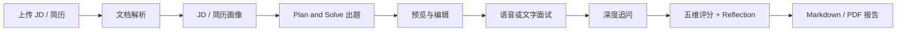

# 智能面试 Agent

面向大厂互联网产品岗位的开源 AI 面试模拟系统：解析 JD / 简历、生成 10 道定制面试题、语音实时问答、深度追问、逐题打分并输出报告。

> **安全提示**：本仓库不包含任何真实 API 密钥。使用前请复制 `.env.example` 为 `.env`，填入你自己的 `LLM_API_KEY`。切勿将 `.env` 提交到 Git。

## 功能

- **预设阶段**：PDF / Word / TXT 文档解析、JD-简历匹配分析、Plan & Solve 生成 10 题，支持预览与编辑
- **对话阶段**：Web 语音面试（TTS 提问 + ASR 转写 + VAD 轮次检测）、2–3 轮深度追问、跳过 / 重答 / 跳题
- **打分阶段**：5 维 Rubric 评分、Reflection 校准、高分参考框架、Markdown / PDF 报告
- **增强功能**：问题预览编辑、岗位模板库、Mock 练习模式、SQLite 会话持久化

## 环境要求

- Python 3.10+
- OpenAI 兼容 LLM API（如[阿里云 DashScope](https://help.aliyun.com/zh/model-studio/developer-reference/compatibility-of-openai-with-dashscope)、OpenAI 或其他兼容服务）
- 麦克风（语音模式）
- 可选：`faster-whisper`（服务端 STT）、`weasyprint`（PDF 导出）

## 快速开始

```bash
# 1. 克隆仓库
git clone https://github.com/<your-username>/smart-interview-agent.git
cd smart-interview-agent

# 2. 建议使用虚拟环境
python -m venv .venv
# Windows:
.venv\Scripts\activate
# macOS / Linux:
# source .venv/bin/activate

# 3. 安装依赖
pip install -r requirements.txt

# 4. 配置环境变量（不要提交 .env）
copy .env.example .env          # Windows
# cp .env.example .env          # macOS / Linux
# 编辑 .env，将 LLM_API_KEY 替换为你自己的密钥

# 5. 启动 Web 服务
python main.py

# 6. 浏览器访问
# http://localhost:8001
```

`.env` 至少需要填写：

| 变量 | 说明 |
|------|------|
| `LLM_API_KEY` | 你的 LLM 服务密钥（必填，切勿公开） |
| `LLM_BASE_URL` | OpenAI 兼容接口地址 |
| `LLM_MODEL_ID` | 模型 ID，如 `qwen-max` |

完整变量见 [`.env.example`](.env.example)。

## CLI 文字模式

不依赖浏览器与麦克风，适合快速跑通流程：

```bash
python cli.py --jd samples/jd_sample.txt --resume samples/resume_sample.txt

# Mock 练习模式（使用模板）
python cli.py --jd samples/jd_sample.txt --resume samples/resume_sample.txt --mock --template bytedance_product_mock
```

示例 JD / 简历位于 `samples/`，内容为虚构样例。

## 项目结构

```
smart-interview-agent/
├── main.py              # FastAPI + WebSocket 入口
├── cli.py               # CLI 文字模式
├── config.py            # 从环境变量读取配置（不含密钥明文）
├── llm_client.py        # OpenAI 兼容 LLM 客户端
├── agents/              # JD 解析、出题、面试 FSM、打分、报告
├── voice/               # TTS、STT、VAD
├── parsers/             # PDF / Word 解析
├── services/            # 流程编排
├── storage/             # SQLite 会话存储
├── static/              # Web 前端
├── prompts/             # Prompt 模板
├── templates/           # 岗位模板库
├── samples/             # 示例 JD / 简历（虚构数据）
└── data/                # 运行时数据（已 gitignore，不会入库）
```

## HTTP / WebSocket 接口

| 接口 | 说明 |
|------|------|
| `POST /api/sessions/upload` | 上传 JD / 简历创建会话 |
| `POST /api/sessions/text` | 文本创建会话 |
| `PUT /api/sessions/{id}/questions` | 编辑预览问题 |
| `POST /api/sessions/{id}/start` | 开始面试 |
| `WS /ws/interview/{id}` | 语音面试 WebSocket |
| `GET /api/sessions/{id}/report` | 下载报告 |

本仓库开源的是**应用程序源码**，不是某个云厂商的 HTTP API 密钥。密钥只应出现在本地 `.env` 中。

## 架构概览



## 安全与隐私

- **不要提交 `.env`**。仓库已通过 `.gitignore` 忽略该文件。
- 面试报告、上传文件、会话数据库、录音均写在 `data/` 下，默认不进入 Git。
- 示例简历为虚构人物「张三」，不包含真实个人信息。
- 若密钥曾经出现在聊天记录、截图或旧提交中，请到对应 LLM 控制台**立即轮换（作废并重新生成）**。

详见 [SECURITY.md](SECURITY.md)。

## 贡献

欢迎 Issue 与 Pull Request。请先阅读 [CONTRIBUTING.md](CONTRIBUTING.md)。

## 许可证

本项目采用 [MIT License](LICENSE)。
